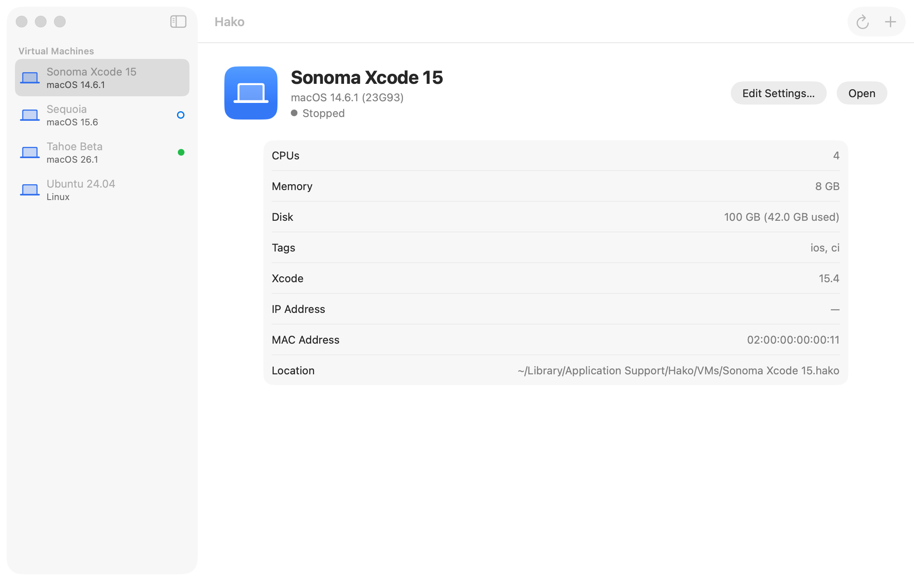
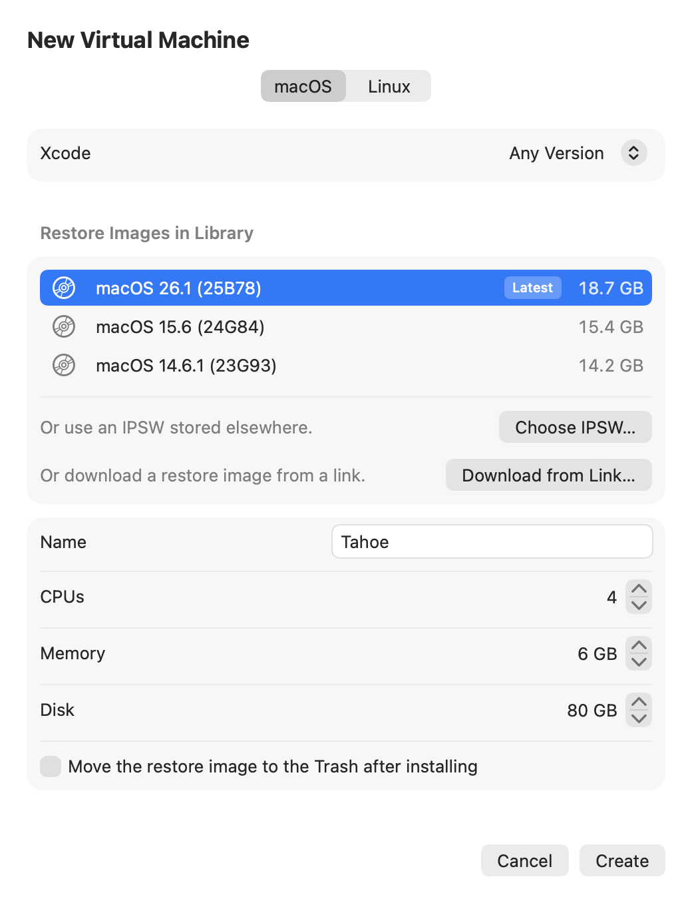
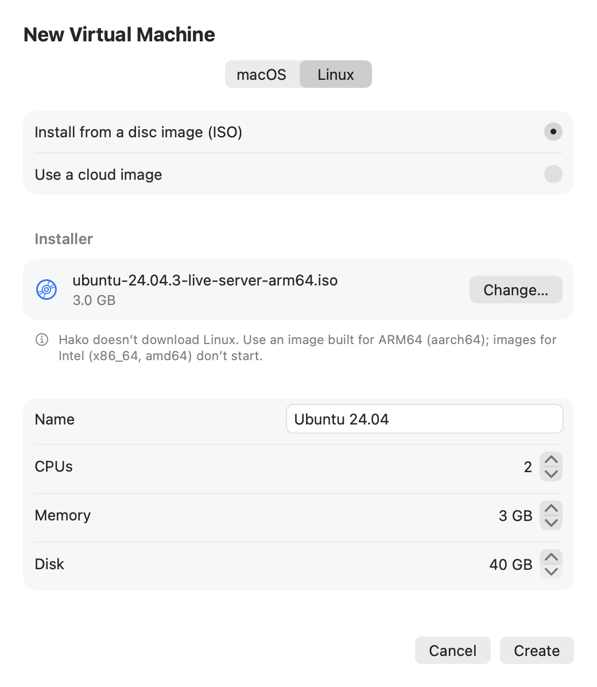
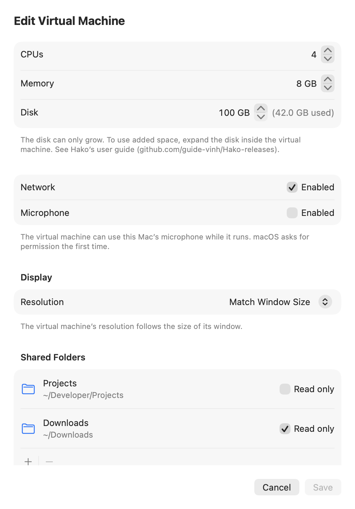
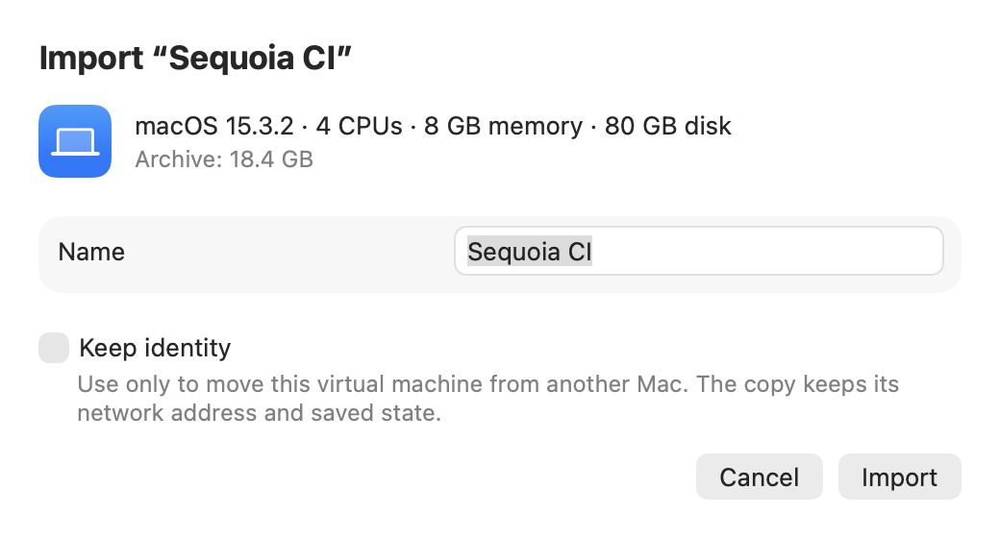

# Hako releases

English | [Tiếng Việt](README.vi.md)

[](https://github.com/guide-vinh/Hako-releases/releases/latest)

Hako (箱, "box") is a small virtualization app for Macs with Apple silicon, built on Apple's Virtualization framework. Each virtual machine (VM) is one `.hako` folder. Hako runs macOS 14 or later guests (for example to keep older Xcode versions around) and Linux ARM64 guests, from the `Hako.app` window or the `hako` command-line tool.

This repository only publishes signed builds (`Hako-<version>.dmg`) and the update feed (`appcast.xml`). It is a personal project; the source code is not public.

<picture>
  <source media="(prefers-color-scheme: dark)" srcset="images/library-dark.png">
  
</picture>

| | | |
| --- | --- | --- |
|  |  |  |
| New VM (macOS) | New VM (Linux) | Edit Settings |



## What's in 0.1.0

- **macOS guests (14 or later):** create a VM from the latest macOS for your Mac (downloaded by Hako), from a link to a restore image on Apple's servers, or from a local IPSW. The wizard can show which macOS versions run the Xcode version you need.
- **Linux ARM64 guests:** install from an ISO, or create from a raw or QCOW2 cloud image with cloud-init (a user with Hako's SSH key). Clipboard sharing (SPICE agent), shared folders (virtiofs), Rosetta for x86_64 programs (see [User guide](#user-guide)), and nested virtualization (Mac with macOS 15 or later; not on M1/M2).
- **Run:** one window per VM, full screen, capture system keys, guest screenshots, Save State and Resume (also on quit), memory warning before Start.
- **Manage:** edit CPU, memory, network, microphone, resolution, grow the disk (never shrinks), tags and Xcode versions; clone (instant on APFS), templates, named snapshots (with the running state if taken while running); several VM libraries, including external disks.
- **Files:** shared folders (read-only by default); drag files onto a VM window to send them to the guest's Inbox; files the guest puts in its Outbox move to your Mac (`~/Downloads` by default); attach `.iso`/`.img`/`.cdr` disk images read-only (Mac with macOS 15 or later).
- **Export / import:** a VM as one Apple Archive (`.aar`) with checksums.
- **`hako` command:** list, start without a window (`--headless`), stop, suspend, resume, clone, snapshots, export/import, `hako ssh` / `hako exec` into macOS guests (after a one-time Remote Login setup in the guest) and Linux VMs created from a cloud image, `hako create --cloud-image` (Linux VM from a cloud image), `hako xcode list|install` (install Xcode from a `.xip` into a guest), and `hako xcodebuild` (build or test a project on your Mac in a VM, optionally in a temporary copy of a template).
- **Updates:** checks for new versions with Sparkle (see [Updates](#updates)).

Not available yet: Windows guests, opening a VM window from `hako` (`start`/`resume` need `--headless`).

Full list of changes: the release notes of each [release](https://github.com/guide-vinh/Hako-releases/releases).

## Requirements

- A Mac with Apple silicon and macOS 14 or later. Tested on an M1 Pro with macOS 26.6.2; macOS 14 and 15 hosts and M4 Macs are not tested yet.
- Guests: macOS 14 or later; Linux for ARM64 (aarch64).
- Disk space: creating a VM needs at least 40 GB free. A freshly installed macOS 26.6.2 VM uses about 26.4 GB, plus about 20 GB for each restore image (IPSW) you keep. VM disks are sparse files: they only use the space the guest has written.
- Apple's license terms allow at most 2 macOS VMs running at the same time; Hako enforces this.
- Limits of Apple's Virtualization framework (as documented by the project, not all tested in Hako): USB passthrough, connecting a real iPhone, cameras, GPU passthrough, x86 guests, bridged networking (VMs use NAT), and clipboard sharing with macOS guests.

## Download and install

1. Click **Download** above, or open the [latest release](https://github.com/guide-vinh/Hako-releases/releases/latest), and download `Hako-<version>.dmg` under **Assets**.
2. Open the `.dmg` and drag `Hako.app` to `Applications`.
3. Open Hako from Applications.

Builds are signed with a Developer ID certificate and notarized by Apple, so Gatekeeper opens them without extra steps (no `Open Anyway` needed). The disk image is stapled, and each release's notes list its SHA-256.

### Verify the download (optional)

```sh
# Compare with the SHA-256 in the release notes
shasum -a 256 ~/Downloads/Hako-*.dmg

# Gatekeeper check: expect "accepted" and "source=Notarized Developer ID"
spctl -a -vv /Applications/Hako.app

# Signing identity: expect TeamIdentifier=T4XT6XZ2WT
codesign -dv /Applications/Hako.app 2>&1 | grep TeamIdentifier
```

### Command-line tool

The `hako` tool ships inside the app. Link it once into your `PATH`:

```sh
sudo mkdir -p /usr/local/bin && sudo ln -sf /Applications/Hako.app/Contents/Helpers/hako /usr/local/bin/hako
hako --version   # hako 0.1.0
hako --help
```

The link breaks if you move `Hako.app` out of `/Applications`; run the command again after moving it.

## Updates

Hako checks for updates with [Sparkle](https://sparkle-project.org), using the feed `https://github.com/guide-vinh/Hako-releases/releases/latest/download/appcast.xml`. How it behaves, by design:

- The second time you open Hako, Sparkle asks whether to check for updates automatically. You can also check any time with `Check for Updates…` in the Hako menu (right after `About Hako`).
- Hako never installs an update without asking you. `Install and Relaunch` quits Hako; if VMs are running, Hako asks first, as when you quit.
- Stop VMs that run with `hako start --headless` before updating: a running `hako` process keeps using the old version until it stops, and a newer `hako` command may fail to talk to it (`The process running “<Name>” couldn’t read the request …`).
- Updates and the update feed are signed with EdDSA; Hako checks the signatures before installing.

## User guide

### Use added disk space in the guest

Hako only makes the VM's disk file larger (`Edit Settings…` → `Disk`; it never shrinks). The new space is at the end of the disk, and the guest can't use it until you expand its partition inside the guest. Back up the VM first (snapshot, clone, or a copy of the `.hako` folder while the VM is shut down).

- **macOS guests:** not confirmed yet. On macOS guests the Recovery partition (`Apple_APFS_Recovery`, about 5.4 GB on a macOS 26.6.2 guest) sits after the main APFS container, so `diskutil apfs resizeContainer` may not be able to take the new space. A tested sequence of commands will be added here.
- **Linux guests:** use your distribution's tools (for example `growpart` and `resize2fs`); not tested with Hako.

### Rosetta in Linux VMs (x86_64 programs)

Off by default.

1. If the Mac doesn't have Rosetta for Linux (`Rosetta for Linux isn’t installed on this Mac.`), click `Install Rosetta…` in `Edit Settings…` → `Integration` (a macOS dialog; you accept its terms yourself).
2. Turn on `Use Rosetta to run x86_64 programs` → `Save`.
3. In the guest, mount the `rosetta` tag and register it with binfmt, as in Apple's [Running Intel Binaries in Linux VMs with Rosetta](https://developer.apple.com/documentation/virtualization/running-intel-binaries-in-linux-vms-with-rosetta):

   ```sh
   sudo mkdir -p /media/rosetta
   sudo mount -t virtiofs rosetta /media/rosetta
   sudo apt install binfmt-support
   sudo /usr/sbin/update-binfmts --install rosetta /media/rosetta/rosetta \
     --magic "\x7fELF\x02\x01\x01\x00\x00\x00\x00\x00\x00\x00\x00\x00\x02\x00\x3e\x00" \
     --mask "\xff\xff\xff\xff\xff\xfe\xfe\x00\xff\xff\xff\xff\xff\xff\xff\xff\xfe\xff\xff\xff" \
     --credentials yes --preserve no --fix-binary yes
   ```

- If Rosetta is on but not installed on the Mac, Start asks `Rosetta isn’t installed on this Mac.` with `Install Rosetta…` / `Start Without Rosetta` / `Cancel`.
- On a Mac without Rosetta support, the VM starts without it and the window shows `Rosetta isn’t available on this Mac, so “<Name>” starts without it.`

## Privacy

- Update checks: Hako connects to `github.com` and GitHub's download host (`release-assets.githubusercontent.com`). Automatic checks run only if you allow them; otherwise only when you choose `Check for Updates…`. GitHub sees your IP address and the app's User-Agent, as with any download.
- Apple's servers (https only): when you open the New VM window (to find the latest macOS for your Mac), when you paste a restore image link (`Checking link…`) and when you download a restore image.
- Hako collects no data and sends no system profile with update checks.
- VMs have NAT networking, so guests connect to the internet on their own; those are the guest's connections, not Hako's.
- Linux guests with clipboard sharing on can read what you copy on your Mac; turn it off per VM if you don't need it.

## Where Hako keeps data

```text
~/Library/Application Support/Hako/
├── IPSW/          downloaded macOS restore images
├── ssh/           Hako's own SSH key (owner-only; never shared into a guest)
└── VMs/
    └── <Name>.hako/   one VM (settings, disk, saved state, snapshots, Inbox/Outbox)
```

Libraries you add on other disks have the same `VMs/` layout. App settings (library list, Settings options, your choice about automatic update checks) are stored in the macOS defaults domain `io.github.guide-vinh.Hako`.

## Uninstall

1. Shut down all VMs and quit Hako.
2. Move `Hako.app` from Applications to the Trash.
3. Remove the command link: `sudo rm /usr/local/bin/hako`.
4. Only if you also want to delete your VMs: delete `~/Library/Application Support/Hako/` (VMs, restore images, Hako's SSH key) and the `VMs/` folders of libraries on other disks. This can't be undone; export VMs you want to keep first.
5. Optional: update checks may also leave `~/Library/Caches/io.github.guide-vinh.Hako/` and `~/Library/HTTPStorages/io.github.guide-vinh.Hako`, which you can delete; run `defaults delete io.github.guide-vinh.Hako`, and remove permissions you granted (microphone, notifications, screen recording, Files & Folders) in System Settings › Privacy & Security.

## Support and security

- Hako is a personal project, provided as is, without warranty or guaranteed support.
- Report bugs in this repository's [Issues](https://github.com/guide-vinh/Hako-releases/issues). Help › `Export Diagnostics…` saves a report (versions, technical VM settings, Hako's log; no notes, shared folder paths, MAC addresses or tags) you can attach after reviewing it.
- Report security vulnerabilities privately through GitHub's private vulnerability reporting (the **Security** tab of this repository), not in public issues.

## License

The Hako builds in this repository are distributed under the MIT License (see [LICENSE](LICENSE)). Hako includes [Sparkle](https://github.com/sparkle-project/Sparkle) (MIT License); its license and those of its components are included in the app (Acknowledgements).

## Tiếng Việt

Bản tiếng Việt đầy đủ: [README.vi.md](README.vi.md).
