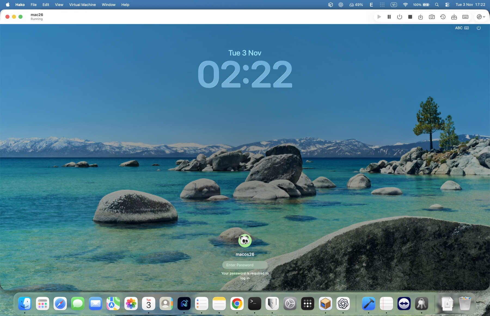
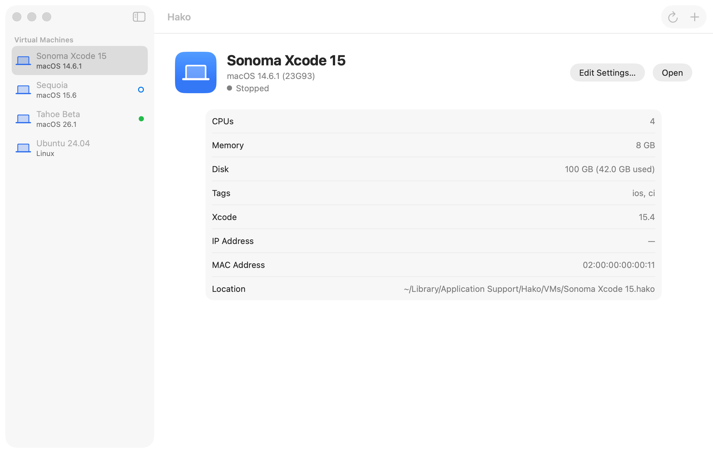
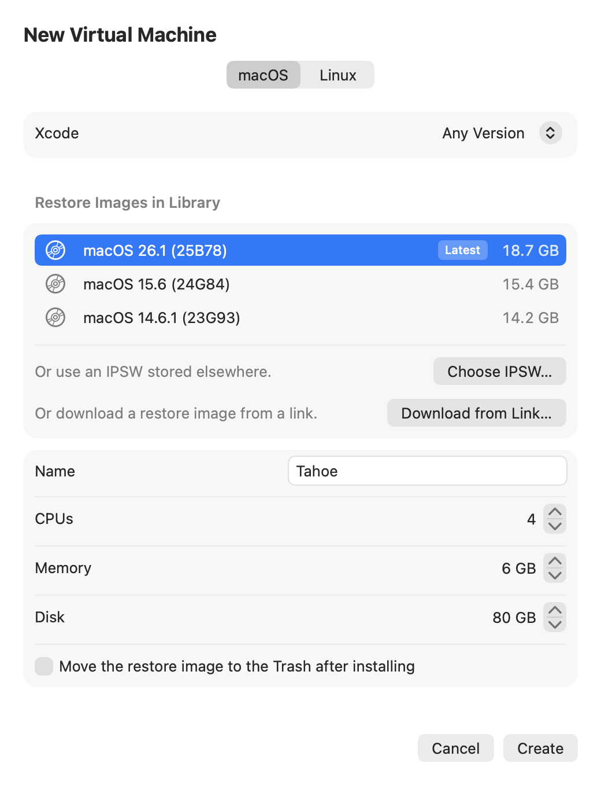
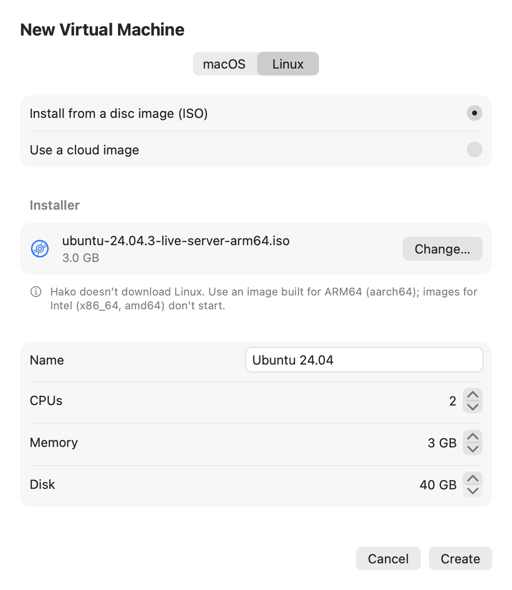
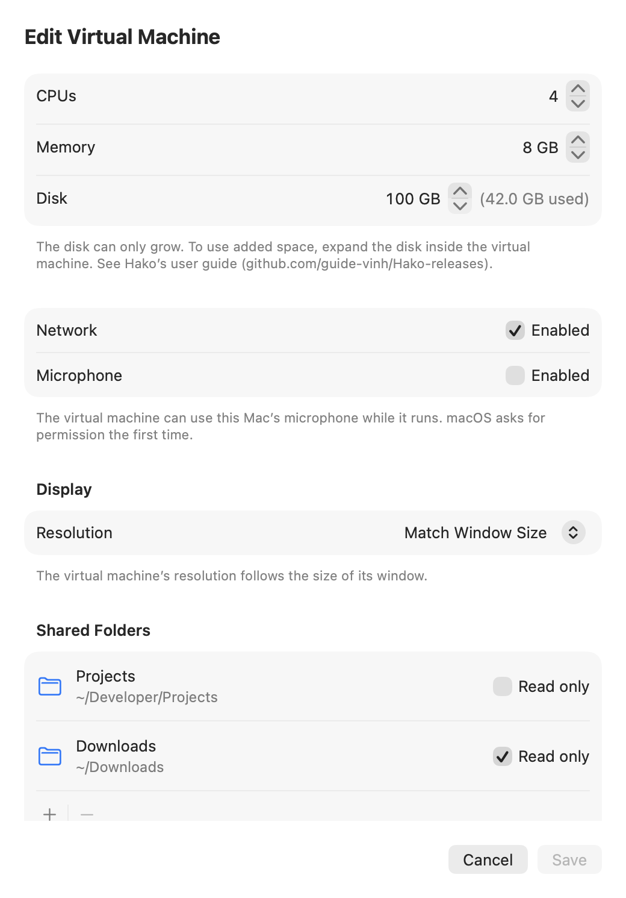
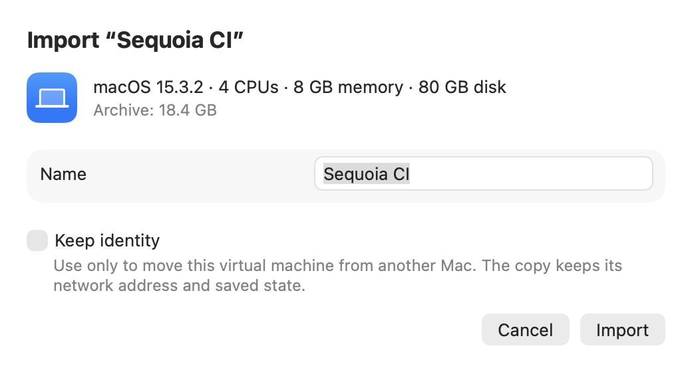

# Bản phát hành Hako

[English](README.md) | Tiếng Việt

[](https://github.com/guide-vinh/Hako-releases/releases/latest)

Hako (箱 — "cái hộp") là app ảo hóa gọn nhẹ cho Mac Apple Silicon, dùng Virtualization.framework của Apple. Mỗi máy ảo (VM) là một thư mục `.hako`. Hako chạy guest macOS 14 trở lên (ví dụ để giữ lại các phiên bản Xcode cũ) và guest Linux ARM64, từ cửa sổ `Hako.app` hoặc lệnh `hako`.

Repo này chỉ đăng bản build đã ký (`Hako-<version>.dmg`) và feed cập nhật (`appcast.xml`). Đây là dự án cá nhân; mã nguồn không công khai.



<picture>
  <source media="(prefers-color-scheme: dark)" srcset="images/library-dark.png">
  
</picture>

| | | |
| --- | --- | --- |
| <picture><source media="(prefers-color-scheme: dark)" srcset="images/new-vm-dark.png"></picture> | <picture><source media="(prefers-color-scheme: dark)" srcset="images/new-vm-linux-dark.png"></picture> | <picture><source media="(prefers-color-scheme: dark)" srcset="images/edit-settings-dark.png"></picture> |
| Tạo VM (macOS) | Tạo VM (Linux) | Sửa cấu hình (Edit Settings) |

<picture><source media="(prefers-color-scheme: dark)" srcset="images/import-dark.png"></picture>

## Có gì trong 0.1.0

- **Guest macOS (14 trở lên):** tạo VM từ bản macOS mới nhất cho Mac của bạn (Hako tải về), từ link restore image trên máy chủ Apple, hoặc từ file IPSW có sẵn. Wizard cho biết những bản macOS nào chạy được phiên bản Xcode bạn cần.
- **Guest Linux ARM64:** cài từ ISO, hoặc tạo từ cloud image raw hay QCOW2 bằng cloud-init (một user dùng khóa SSH của Hako). Chia sẻ clipboard (SPICE agent), thư mục chia sẻ (virtiofs), Rosetta để chạy chương trình x86_64 (xem [Hướng dẫn sử dụng](#hướng-dẫn-sử-dụng)), và nested virtualization (Mac chạy macOS 15 trở lên; không có trên M1/M2).
- **Chạy:** mỗi VM một cửa sổ, toàn màn hình, bắt phím hệ thống, chụp màn hình guest, Save State và Resume (cả khi thoát app), cảnh báo RAM trước khi Start.
- **Quản lý:** sửa CPU, RAM, mạng, micro, độ phân giải, tăng disk (không bao giờ thu nhỏ), nhãn và phiên bản Xcode; clone (tức thì trên APFS), template, snapshot có tên (kèm trạng thái đang chạy nếu chụp lúc VM chạy); nhiều thư viện VM, kể cả trên ổ ngoài.
- **File:** thư mục chia sẻ (mặc định chỉ đọc); kéo file thả vào cửa sổ VM để gửi vào Inbox của guest; file guest đặt vào Outbox được chuyển sang Mac (mặc định `~/Downloads`); gắn ảnh đĩa `.iso`/`.img`/`.cdr` chỉ đọc (Mac chạy macOS 15 trở lên).
- **Export / import:** đóng một VM thành một file Apple Archive (`.aar`) kèm checksum.
- **Lệnh `hako`:** liệt kê, chạy không cửa sổ (`--headless`), tắt, lưu trạng thái, chạy tiếp, clone, snapshot, export/import, `hako ssh` / `hako exec` vào guest macOS (sau khi bật Remote Login một lần trong guest) và VM Linux tạo từ cloud image, `hako create --cloud-image` (tạo VM Linux từ cloud image), `hako xcode list|install` (cài Xcode từ file `.xip` vào guest), và `hako xcodebuild` (build hoặc test dự án trên Mac trong một VM, có thể trong bản sao tạm của một template).
- **Cập nhật:** kiểm bản mới bằng Sparkle (xem [Cập nhật](#cập-nhật)).

Chưa có: guest Windows, mở cửa sổ VM từ `hako` (`start`/`resume` cần `--headless`).

Danh sách thay đổi đầy đủ: release notes của từng [bản phát hành](https://github.com/guide-vinh/Hako-releases/releases).

## Yêu cầu

- Mac Apple Silicon chạy macOS 14 trở lên. Đã kiểm trên M1 Pro chạy macOS 26.6.2; máy chạy macOS 14, 15 và máy M4 chưa kiểm.
- Guest: macOS 14 trở lên; Linux cho ARM64 (aarch64).
- Dung lượng ổ: tạo một VM cần ít nhất 40 GB trống. Một VM macOS 26.6.2 vừa cài chiếm khoảng 26,4 GB, cộng khoảng 20 GB cho mỗi restore image (IPSW) bạn giữ lại. Disk của VM là file sparse: chỉ chiếm phần guest đã ghi.
- Điều khoản giấy phép của Apple cho phép chạy cùng lúc tối đa 2 VM macOS; Hako áp giới hạn này.
- Giới hạn của Virtualization.framework (theo tài liệu của dự án, chưa kiểm hết trên Hako): USB passthrough, kết nối iPhone thật, camera, GPU passthrough, guest x86, bridged network (VM dùng NAT), và clipboard chung với guest macOS.

## Tải và cài đặt

1. Bấm nút **Tải về** ở trên, hoặc mở [bản phát hành mới nhất](https://github.com/guide-vinh/Hako-releases/releases/latest), rồi tải `Hako-<version>.dmg` ở mục **Assets**.
2. Mở file `.dmg` và kéo `Hako.app` vào `Applications`.
3. Mở Hako từ thư mục Applications.

Bản build được ký bằng chứng chỉ Developer ID và đã được Apple notarize, nên Gatekeeper mở bình thường, không cần bước thêm (không cần `Open Anyway`). File `.dmg` đã được staple, và release notes của mỗi bản ghi SHA-256 của nó.

### Kiểm file tải về (tùy chọn)

```sh
# Compare with the SHA-256 in the release notes
shasum -a 256 ~/Downloads/Hako-*.dmg

# Gatekeeper check: expect "accepted" and "source=Notarized Developer ID"
spctl -a -vv /Applications/Hako.app

# Signing identity: expect TeamIdentifier=T4XT6XZ2WT
codesign -dv /Applications/Hako.app 2>&1 | grep TeamIdentifier
```

- `shasum`: so với SHA-256 trong release notes.
- `spctl`: kết quả phải có `accepted` và `source=Notarized Developer ID`.
- `codesign`: phải thấy `TeamIdentifier=T4XT6XZ2WT`.

### Lệnh `hako`

Lệnh `hako` nằm sẵn trong app. Tạo link vào `PATH` một lần:

```sh
sudo mkdir -p /usr/local/bin && sudo ln -sf /Applications/Hako.app/Contents/Helpers/hako /usr/local/bin/hako
hako --version   # hako 0.1.0
hako --help
```

Dời `Hako.app` ra khỏi `/Applications` thì link bị gãy; chạy lại lệnh trên sau khi dời.

## Cập nhật

Hako kiểm cập nhật bằng [Sparkle](https://sparkle-project.org), dùng feed `https://github.com/guide-vinh/Hako-releases/releases/latest/download/appcast.xml`. Cách hoạt động theo thiết kế:

- Lần thứ hai mở Hako, Sparkle hỏi có tự động kiểm cập nhật không. Bạn cũng có thể kiểm bất cứ lúc nào bằng `Check for Updates…` trong menu Hako (ngay sau `About Hako`).
- Hako không bao giờ cài bản cập nhật khi chưa hỏi bạn. `Install and Relaunch` sẽ thoát Hako; nếu có VM đang chạy, Hako hỏi trước, như khi bạn thoát app.
- Dừng các VM chạy bằng `hako start --headless` trước khi cập nhật: tiến trình `hako` đang chạy vẫn dùng bản cũ cho tới khi dừng, và lệnh `hako` mới hơn có thể không nói chuyện được với nó (`The process running “<Name>” couldn’t read the request …`).
- Bản cập nhật và feed cập nhật được ký bằng EdDSA; Hako kiểm chữ ký trước khi cài.

## Hướng dẫn sử dụng

### Dùng phần disk vừa tăng trong guest

Hako chỉ làm file disk của VM lớn hơn (`Edit Settings…` → `Disk`; không bao giờ thu nhỏ). Phần mới nằm ở cuối disk, và guest chưa dùng được cho tới khi bạn mở rộng phân vùng bên trong guest. Hãy sao lưu VM trước (snapshot, clone, hoặc chép thư mục `.hako` khi VM đã tắt).

- **Guest macOS:** chưa xác nhận. Trên guest macOS, phân vùng Recovery (`Apple_APFS_Recovery`, khoảng 5,4 GB trên guest macOS 26.6.2) nằm sau container APFS chính, nên `diskutil apfs resizeContainer` có thể không lấy được phần mới. Trình tự lệnh đã kiểm sẽ được bổ sung ở đây.
- **Guest Linux:** dùng công cụ của bản phân phối (ví dụ `growpart` và `resize2fs`); chưa kiểm với Hako.

### Rosetta trong VM Linux (chạy chương trình x86_64)

Mặc định tắt.

1. Nếu Mac chưa có Rosetta for Linux (`Rosetta for Linux isn’t installed on this Mac.`), bấm `Install Rosetta…` trong `Edit Settings…` → `Integration` (hộp thoại của macOS; bạn tự đồng ý điều khoản).
2. Bật `Use Rosetta to run x86_64 programs` → `Save`.
3. Trong guest, gắn tag `rosetta` và đăng ký với binfmt, theo tài liệu của Apple [Running Intel Binaries in Linux VMs with Rosetta](https://developer.apple.com/documentation/virtualization/running-intel-binaries-in-linux-vms-with-rosetta):

   ```sh
   sudo mkdir -p /media/rosetta
   sudo mount -t virtiofs rosetta /media/rosetta
   sudo apt install binfmt-support
   sudo /usr/sbin/update-binfmts --install rosetta /media/rosetta/rosetta \
     --magic "\x7fELF\x02\x01\x01\x00\x00\x00\x00\x00\x00\x00\x00\x00\x02\x00\x3e\x00" \
     --mask "\xff\xff\xff\xff\xff\xfe\xfe\x00\xff\xff\xff\xff\xff\xff\xff\xff\xfe\xff\xff\xff" \
     --credentials yes --preserve no --fix-binary yes
   ```

- Rosetta bật mà Mac chưa cài: Start hỏi `Rosetta isn’t installed on this Mac.` với `Install Rosetta…` / `Start Without Rosetta` / `Cancel`.
- Trên Mac không hỗ trợ Rosetta, VM vẫn Start nhưng không có Rosetta, và cửa sổ báo `Rosetta isn’t available on this Mac, so “<Name>” starts without it.`

## Quyền riêng tư

- Kiểm cập nhật: Hako kết nối tới `github.com` và máy chủ tải của GitHub (`release-assets.githubusercontent.com`). Kiểm tự động chỉ chạy nếu bạn cho phép; nếu không thì chỉ khi bạn chọn `Check for Updates…`. GitHub thấy địa chỉ IP và User-Agent của app, như với mọi lần tải.
- Máy chủ Apple (chỉ https): khi bạn mở cửa sổ New VM (để tìm bản macOS mới nhất cho Mac của bạn), khi dán link restore image (`Checking link…`) và khi tải restore image.
- Hako không thu thập dữ liệu và không gửi thông tin cấu hình máy khi kiểm cập nhật.
- VM dùng mạng NAT nên guest tự kết nối Internet; đó là kết nối của guest, không phải của Hako.
- Guest Linux bật chia sẻ clipboard đọc được những gì bạn chép trên Mac; tắt theo từng VM nếu không cần.

## Nơi Hako lưu dữ liệu

```text
~/Library/Application Support/Hako/
├── IPSW/          file restore image macOS đã tải
├── ssh/           khóa SSH riêng của Hako (chỉ chủ sở hữu đọc được; không chia sẻ vào guest)
└── VMs/
    └── <Name>.hako/   một VM (cấu hình, disk, trạng thái đã lưu, snapshot, Inbox/Outbox)
```

Thư viện bạn thêm trên ổ khác có cùng cấu trúc `VMs/`. Thiết lập của app (danh sách thư viện, các lựa chọn trong Settings, lựa chọn tự kiểm cập nhật) lưu trong defaults của macOS, miền `io.github.guide-vinh.Hako`.

## Gỡ cài đặt

1. Tắt mọi VM và thoát Hako.
2. Kéo `Hako.app` từ Applications vào Thùng rác.
3. Xóa link lệnh: `sudo rm /usr/local/bin/hako`.
4. Chỉ khi muốn xóa cả VM: xóa `~/Library/Application Support/Hako/` (VM, restore image, khóa SSH của Hako) và các thư mục `VMs/` của thư viện trên ổ khác. Việc này không hoàn tác được; export các VM cần giữ trước.
5. Tùy chọn: việc kiểm cập nhật có thể để lại `~/Library/Caches/io.github.guide-vinh.Hako/` và `~/Library/HTTPStorages/io.github.guide-vinh.Hako`, bạn có thể xóa; chạy `defaults delete io.github.guide-vinh.Hako`, và gỡ các quyền đã cấp (micro, thông báo, ghi màn hình, Files & Folders) ở System Settings › Privacy & Security.

## Hỗ trợ và bảo mật

- Hako là dự án cá nhân, cung cấp nguyên trạng, không bảo hành và không cam kết hỗ trợ.
- Báo lỗi ở [Issues](https://github.com/guide-vinh/Hako-releases/issues) của repo này. Help › `Export Diagnostics…` lưu một báo cáo (phiên bản, cấu hình kỹ thuật của VM, log của Hako; không gồm ghi chú, đường dẫn thư mục chia sẻ, địa chỉ MAC hay nhãn) mà bạn có thể đính kèm sau khi xem lại.
- Báo lỗ hổng bảo mật một cách riêng tư qua tính năng private vulnerability reporting của GitHub (tab **Security** của repo này), không đăng ở issue công khai.

## Giấy phép

Bản build Hako trong repo này phát hành theo giấy phép MIT (xem [LICENSE](LICENSE)). Hako có kèm [Sparkle](https://github.com/sparkle-project/Sparkle) (giấy phép MIT); giấy phép của Sparkle và các thành phần của nó đi kèm trong app (Acknowledgements).
